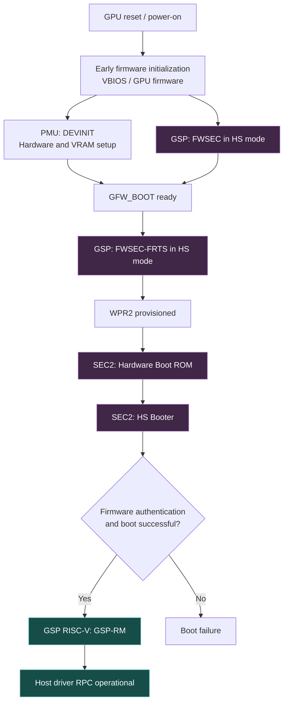
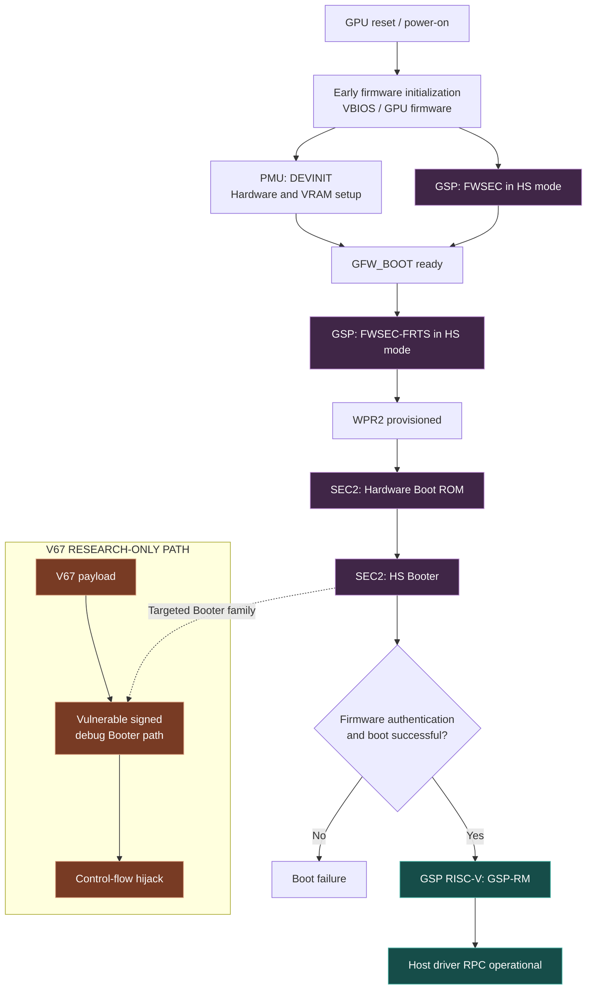

# How Nvidia Ampere generation GPUs got unlocked

In the past few months various unlocks of Nvidia Ampere GPUs have popped up that all exploit the same fundamental flaw in the boot process.

Amongst these the most famous is probably [https://github.com/amoghmunikote/cmpunlocker](https://github.com/amoghmunikote/cmpunlocker), that's been covered on LTT and various other famous sites, which unlocks the 8/10 GB CMP 170hx cards to 64GB and 40GB respectively.

## The Ampere boot process

In short both Nouveau and NVIDIA's open GPU driver boot process looks like this:

### 1. PCI initialization:

The kernel driver probes the GPU, maps Base Address Registers (BAR) for Memory-mapped I/O (MMIO) access, and establishes Direct Memory Access-capable (DMA) memory.

### 2. Firmware loading

The driver retrieves firmware blobs using the Linux firmware infrastructure (Nouveau uses request_firmware()), including GPU System Processor – Resource Manager (GSP-RM), bootloaders, and auxiliary microcode.

### 3. Initial hardware setup

VBIOS-provided Firmware Security (FWSEC) and devinit firmware initialize critical hardware, including VRAM, clocks, and power sequencing. Much of this happens before the driver loads.

### 4. Secure boot preparation

The driver executes FWSEC Firmware Runtime Services (FRTS) on the GPU System Processor (GSP) Falcon in heavy-secure mode, establishing a protected VRAM region (WPR2).

### 5. GSP bootstrap

The driver launches a signed Booter firmware on the Security Engine 2 (SEC2) security processor. SEC2 authenticates and loads GSP-RM onto the GSP.

### 6. Runtime initialization

GSP-RM starts, initializes GPU subsystems, and establishes shared-memory RPC queues with the host driver.

## The "secure" boot preparation

This is where the exploit happens and it's rather ingenious. 

The SEC2 runs firmware (booter) loaded by the driver via hardware DMA that does the decryption and verification.  
The job of this firmware is to receive the encrypted GSP firmware from the driver via a DMA channel, verify the signature, decrypt it and finally execute it on the GSP.

Unfortunately for Nvidia the booter is vulnerable to a classic buffer overflow that writes straight into the stack which gives us the ability to execute code via Return Oriented Programming (ROP).

ROPs basically exploit a common functionality in many CPU architectures to have dedicated instructions for calling and returning from functions. The `call` instruction will jump to code at a specific address but before doing so push the address of the instruction right after itself onto the stack. The return (`ret`) instruction pops this address from the stack and jumps there to continue in the original function.  
Since we can write arbitrary values to the stack we can now control this return address and start to string pieces of firmware code together to build our exploit.

These pieces of existing code are referred to as "gadgets" and finding them is referred to as "mining".  
Now you might wonder how did anyone ever figure out that the booter firmware happens to have a buffer overflow when the firmware is completely inaccessible?  
As it turns out Nvidia fucked up more than once and for a while published both debug and production booter firmware blobs which in of itself isn't a problem as they're all encrypted.  
But as it turns out some very clever people found out that Nvidia encrypted the debug image with a known public test-key scheme (key index 37). So with the decrypted firmware it could now be dissassembled and mined for gadgets.  
The debug image isn't *exactly* the same as the production one but it's remarkably similar.

Armed with these tools it was just a matter of time before researchers would figure out how to exploit the access gained with code execution in "heavy secure" mode.

Eventually this resulted in the v67 payload that this driver uses. The payload utilizes a sequence of gadgets that eventually writes a word (4 bytes) from the payload to a word address also from the payload effectively giving us a single `MEMORY[payload_address_word] = payload_value_word` write.

## Unlocking

The registers that governs the issue rate of various instructions are 

| Name                        | Address      | GA102 default value | Governs                                                           |
| --------------------------- | ------------ | ------------------- | ----------------------------------------------------------------- |
| `FEAT_OVR_SM_SPD` (`SS0`)   | `0x0082381c` | `0x00000001`        | Eight 4-bit fields covering DP, FFMA, FMLA16, FMLA32, and IMLA0–3 |
| `FEAT_OVR_SM_SPD_1` (`SS1`) | `0x00823820` | `0x00000001`        | One 4-bit field at [3:0], attributed to IMLA4                     |

Each 4-bit field is encoded as:

- `bit 3`: Override enabled 
- `bits 2:0`: Speed selector 
  - `00` = full rate 
  - `01` = 1/2 rate
  - `10` = 1/4 rate (unconfirmed)
  - `11` = 1/8 rate (unconfirmed)

As such our target is to write `0x88888888` to `SS0` and `0x8` to `SS1` but naturally these aren't writeable from the host side (aka the driver) and writing there just does nothing, that would be too easy after all. 
So we need to write there somehow but the problem is our ROP gadget is already near the size limit so we cannot perform 2 writes and launching the booter multiple has it's own problems.
But luckily the solution to everything in computer science is yet another indection and Nvidia thought so as well. So the access to these registers is actually governed by other registers called Privilige Level Masks (PLM).

The [inferred from observed behavior model of the PLM bitfields](https://github.com/Consensus-Protocol/cmp170hx/blob/main/docs/unlock/privilege-level-masks.md#2-bit-encoding) describes the read/write level-enable masks as follows:

- Bits `[3:0] = READ_PROTECTION`: one bit per privilege level (L0/L1/L2/L3). A set bit = that level may read.
- Bits `[7:4] = WRITE_PROTECTION`: one bit per level. A set bit = that level may write.
- Bits `[23:8] = SOURCE_ENABLE`: controls which on-die sources may issue accesses.

Our two registers happens to be governed by the same `FEAT_OVR_PLM` register at `0x00823804` which contains `0xffffff8f` by default on all GA100 and GA102 cards.

Reading `0x8f` in the low byte = `1000 1111`:

- `[3:0] = 1111`: Readable from all four privilege levels.
- `[7:4] = 1000`: Only L3 may write; L0/L1/L2 writes are blocked. In this model, L3 corresponds to the heavy-secure context, and bit 7 enables its writes.

So with that all we've gotta do is write `0xFFFFFFFF` to `FEAT_OVR_PLM` from within our ROP gadget and suddenly `SS0+SS1` is writable from the host driver. 

> Great success

As Borat would say.